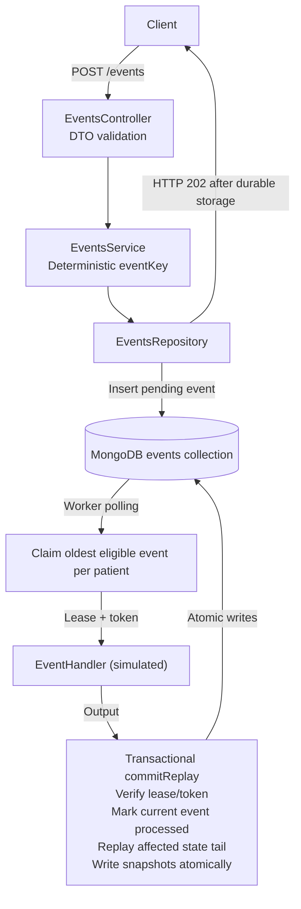

# Architecture, decisions, fixes and roadmap

## 1. Purpose and scope

This project is a small asynchronous event-ingestion service. It accepts
patient events, acknowledges them after durable storage, and processes them
outside the HTTP request. Each event currently takes about five seconds in a
simulated handler.

The design prioritizes:

1. Simple local setup and understandable code.
2. Durable acceptance before returning success.
3. Idempotent client retries.
4. Parallel processing across patients, with sequential work per patient.
5. Correct patient state when events arrive out of chronological order.
6. Recovery after a worker or database interruption.

It is a development and assignment implementation, not yet a complete
production platform. The handler is simulated, MongoDB is a single local
replica-set member in Compose, and long-term retention and operations still
need design.

## 2. Architecture at a glance

The project is a modular monolith. The HTTP API, worker, and repository are
modules in the same NestJS process. MongoDB serves as both durable event store
and work queue.



This avoids an extra broker and a dual-write problem: the accepted event and
the worker's queue are the same MongoDB document. The trade-off is that queue
claiming and event history share the same database resources and operational
limits.

## 3. Ingestion contract

### Request

`POST /events` accepts a JSON object with:

| Field | Meaning |
| --- | --- |
| `patientId` | Patient key; required non-empty string |
| `type` | Event type; required non-empty string |
| `data` | Event payload; required object |
| `ts` | Source event timestamp; required date string |

Nest's global validation pipe uses `whitelist: true`; class-validator decorators
are in `src/events/dto/create-event.dto.ts`.

### Acceptance semantics

The service computes:

```text
eventKey = SHA-256(patientId, type, normalized ISO timestamp)
```

It inserts the event with `status: pending` and `receivedAt`, then responds
`202 Accepted`. The handler does not run in the HTTP request. A unique
`eventKey` index makes a repeated identity idempotent; the response body
indicates whether the event was a duplicate.

The event key intentionally omits `data`. Therefore, two semantically
different payloads sharing a patient, type and timestamp collapse into one
stored event. This identity rule must be confirmed against the real producer
contract; if it is not valid, add a producer event ID or include a canonical
payload identity before production.

The API acknowledges only after MongoDB confirms insertion. This is the
durability boundary: returning 202 before the write would risk acknowledging
an event that was never persisted.

## 4. Persisted event and state model

`EventDocument` is stored in the `events` collection:

| Field | Role |
| --- | --- |
| `eventKey` | Deterministic idempotency key |
| `patientId`, `type`, `data`, `ts` | Event identity, payload and source ordering |
| `status` | `pending`, `processing` or `processed` |
| `receivedAt` | Ingestion time |
| `leaseUntil` | Expiry of the current processing claim |
| `claimToken` | Fencing token for the current lease owner |
| `output` | Handler result persisted for replay |
| `processedAt` | Completion time |
| `stateAfter` | Patient aggregate after this event in canonical order |

The two clocks have different purposes:

- `ts` is source event time and determines canonical patient-state order.
- `receivedAt` and `processedAt` are service-side operational timestamps.

The canonical order is `(ts, eventKey)`. `eventKey` breaks timestamp ties
deterministically.

`PatientState` currently contains:

- `eventCount`;
- `latestByType`;
- `asOf`.

`applyEvent` is pure: it returns a new state and throws if an event has no
persisted `output`. `replay` applies an ordered list to a starting snapshot and
returns a `stateAfter` for every event.

## 5. Worker claiming, concurrency and leases

### Per-patient serialization

Different patients can be processed concurrently. Only one event for a given
patient may be in `processing` at a time. This prevents the worker from
advancing a patient's state past an unfinished earlier event.

`claimBatch` aggregates unfinished events, orders them so an expired
`processing` event is considered before later pending events, groups by
patient, and selects each patient's oldest unfinished event if it has no live
lease. The repository then claims each candidate with an atomic
`findOneAndUpdate`, assigning:

- `status: processing`;
- a `leaseUntil` timestamp;
- a fresh random `claimToken`.

The unique partial index `one_processing_per_patient` is a database-level
backstop. Concurrent workers cannot both hold a processing document for the
same patient. A duplicate-key conflict means another worker won the claim.

### Lease and fencing

A lease makes abandoned work recoverable after a process crash. After expiry,
another worker can reclaim the event with a new token. The token fences stale
workers: `commitReplay` only changes the document if status, token and
unexpired lease still match. If the lease was reclaimed, the old result cannot
be committed.

A lease is not exactly-once execution. If a worker finishes external work and
crashes before committing, that external work may be called again after
reclaim. Side-effecting integrations must support an idempotency key, ideally
the event key, or another safe deduplication mechanism.

### Concurrency sizing

The worker's in-memory concurrency is bounded by `WORKER_CONCURRENCY` per
process. A first-order estimate comes from Little's law:

```text
required in-flight events ≈ arrival rate × average processing time
```

At 100 events/s and a five-second handler, the base requirement is about 500
in-flight events. Commit time, retries, database contention and variability
require additional headroom. The configured value of 800 is a benchmark
setting, not a guarantee that one small MongoDB instance can sustain it.

`MONGO_MAX_POOL_SIZE` controls the driver's maximum pool size per server and
per application process. It is distinct from worker concurrency. Raising it
can reduce driver-side waiting only if MongoDB can serve more operations; it
can also increase contention. Tune it from pool wait metrics and Mongo
capacity, not by setting it equal to worker concurrency by default.

## 6. Transactional processing and patient-state replay

The slow handler runs outside a Mongo transaction. After it returns `output`,
`commitReplay` uses a transaction to:

1. Match and update the event only when the current lease token is valid.
2. Mark it processed and persist its `output`.
3. Find the last processed event preceding the current event in `(ts,
   eventKey)` order.
4. Start from that predecessor's `stateAfter`, or from `initialState`.
5. Read the current event and every processed event after it in canonical
   order.
6. Recompute and write snapshots for that affected tail.

The event completion and all affected snapshots commit atomically. A
transaction failure rolls them all back, and a stale lease cannot publish a
snapshot.

For an in-order event with a valid predecessor snapshot, the replay touches
the predecessor snapshot and the tail, usually just the current event. Its
cost is independent of the history before that predecessor. A late event must
still rebuild all later snapshots, so cost is proportional to the tail length.

Legacy processed documents missing snapshots may trigger a full replay
fallback. A processed event missing `output` cannot be replayed and causes an
explicit failure; it needs a migration or remediation, not a fabricated value.

## 7. MongoDB and local development topology

The official MongoDB Node.js driver is used instead of an ODM to keep database
access explicit and reduce abstraction. A global Nest provider shares one
`MongoClient`; shutdown hooks close it.

The Compose MongoDB service starts a one-member replica set because MongoDB
transactions require a replica-set or sharded deployment. The Compose
healthcheck initializes it and waits for a writable primary. The app connects
using the Compose service name and `directConnection=true`.

This local topology:

- supports transaction and fail/restart testing;
- persists data in the named `mongo-data` volume;
- is **not highly available**—there is one MongoDB member;
- does not model production failover, backups, network boundaries or
  multi-zone behavior.

`docker compose down` stops and removes containers but keeps the named volume
unless explicitly removed. To delete local data, a user may run
`docker compose down -v`; this is destructive and must only be done when the
volume contents are disposable.

## 8. Database indexes

The repository creates these indexes at startup:

| Index | Purpose |
| --- | --- |
| Unique `{ eventKey: 1 }` | Enforce idempotency |
| Unique partial `{ patientId: 1 }` where `status: processing` | Enforce at most one claimed event per patient |
| `{ patientId: 1, ts: 1, eventKey: 1 }` | Locate predecessor/tail and order a patient's events |
| Partial `{ ts: 1 }` for `pending`/`processing` | Restrict the unfinished-work index to queue items |

The unfinished index stays smaller than an index over all processed history,
but the claim aggregation still examines/group unfinished work. A large
backlog can make claim operations expensive. The unique event-key index and
patient history index continue growing as the event history is retained.

## 9. Gaps identified and fixes implemented

The implementation evolved in response to correctness and load-test findings:

| Gap or risk found | Fix in the current design | Remaining limitation |
| --- | --- | --- |
| Arrival order can differ from source timestamp order, producing incorrect snapshots if state is updated only in processing order. | Persist handler outputs, replay in `(ts, eventKey)` order and rewrite affected later snapshots. | Late events can make replay tails large. |
| Two workers could otherwise claim different events for the same patient. | Per-patient oldest-unfinished selection plus a unique partial `processing` index. | Claiming uses aggregation and per-event updates; large queues may stress MongoDB. |
| A stale worker might publish output or snapshots after its lease was reclaimed. | Lease token validation and event update, replay and snapshot writes in one Mongo transaction. | The external handler call remains at-least-once and must be idempotent when it has side effects. |
| Replaying the entire patient history on every event made normal commits grow with historical length. | Incremental replay starts from the previous snapshot and recomputes only the affected tail. | A very late event still requires recomputing the later tail. |
| A process crash could leave work stuck indefinitely. | Lease expiry permits reclaim; startup resumes polling. | Recovery waits for lease expiry; no attempt limit, backoff or dead-letter workflow yet. |
| A timed-out load-test client could misclassify a late server insert as a lost event. | Load script retries network failures, 5xx and 429 using the same deterministic event identity. | The production client contract/retry policy is not implemented by this repository. |
| Local transaction testing would not work against a standalone MongoDB server. | Compose runs a single-node replica set and initializes it with a healthcheck. | One member provides no availability or failover. |

The correctness checks are covered by unit tests for pure state replay and
MongoDB-backed tests for claims, lease recovery, stale owners, ordering,
transaction rollback and uniqueness. Load scripts additionally validate
stored event counts and every generated snapshot for their synthetic run.

Current worktree caveat: Vitest also discovers zero-byte placeholder specs in
`src/database/` and `src/processing/`, which fail with “No test suite found.”
Populate or remove those placeholders before treating the complete unit-test
command as green; targeted tests and the end-to-end suite can still be run
separately.

## 10. Benchmark evidence

Benchmarks are snapshots under specific local machine conditions; they are not
capacity guarantees.

### Normal load on a quiet host

The three-minute quiet-host run sent 18,000 events at 100 events/s with 800
worker slots. It reported 18,000 accepted/stored/processed, no snapshot
mismatches, API p95 around 31 ms, maximum pending 60 and 10.3 seconds to drain.
The host load average was 3.4–4.3. Mongo peaked near one CPU on a two-CPU Docker
VM. Full details: [quiet-host benchmark](./load-test-3000-patients-quiet-host-report.md).

### Fault injection

The five-minute run stopped/restarted the app, restarted Mongo, and paused the
app. It ultimately processed 30,000 events without loss or snapshot mismatch;
retries and request latency increased during interruptions. Details:
[five-minute fault run](./fault-injection-soak-report.md).

The ten-minute run applied the same three fault types to a 60,000-event
workload. It ultimately processed all events without snapshot mismatches, but
had a maximum sampled backlog of 4,510, p99 request latency around 15.1
seconds, and one Mongo slow operation around 36 seconds during app recovery.
Details: [ten-minute fault run](./10-minute-fault-soak-report.md).

These runs establish that the tested synthetic workload recovered from those
specific short interruptions. They do not establish sustained multi-hour or
multi-day reliability, realistic behavior of an external system, or performance
with production-sized histories and indexes.

## 11. Known gaps and future improvements

Prioritized by operational importance:

### Before production

1. **Replace the simulated handler.** Add explicit connect/request timeouts,
   external idempotency, bounded concurrency and handling for rate limits.
2. **Retry policy and poison events.** Persist attempts and next retry time;
   add exponential backoff, max attempts, a dead-letter state and operator
   replay tooling. Today a failure waits for the lease to expire and may retry
   indefinitely.
3. **Retention and archival.** Processed events are not deleted. Define an
   audit retention window, archive strategy, per-patient snapshot retention,
   and a safe compaction/migration plan.
4. **Observability.** Add structured request/event correlation, metrics for
   accepted/processed rates, queue age/depth, lease reclaim, handler latency,
   Mongo pool wait, transaction retries, memory, disk and oplog. `/health`
   currently checks only Mongo ping.
5. **Production Mongo topology and operations.** Use a supported multi-member
   replica set or managed cluster, backups/restore tests, resource limits,
   disk alerts and an appropriate oplog recovery window.
6. **Define event identity.** Confirm whether `patientId + type + ts` uniquely
   identifies an event. If not, require a producer-supplied immutable ID.

### Scale and performance

7. **Measure and improve claims.** The claim pipeline groups unfinished events
   and then issues per-candidate atomic updates. Benchmark a queue-head or
   partitioned strategy and consider bulk claiming without weakening
   per-patient exclusivity.
8. **Test connection-pool tuning.** Observe pool checkout wait and Mongo CPU
   before changing `MONGO_MAX_POOL_SIZE`; the driver default is 100.
9. **Scale API and workers separately.** `WORKER_ENABLED` supports a process
   without a worker, but Compose currently defines one combined app service.
   Separate deployment roles can scale request handling and processing
   independently. Ensure one-patient serialization still spans all workers.
10. **Long-history strategy.** Benchmark late-event rate and replay-tail size.
    If tails become large, consider explicit checkpoints, a bounded correction
    window or a redesigned aggregate. Any retention scheme must preserve the
    state needed for future late events.
11. **Soak and recovery tests.** Run repeated multi-hour tests with
    production-shaped data, track trends, and exercise app/Mongo failures,
    backup restoration and recovery from a growing backlog.

See [soak-test risks](./soak-test-risks.md) for the risk inventory and signals
to monitor over longer runs.

## 12. Test and benchmark commands

From the repository root:

```bash
# Full test workflow in Compose (starts Mongo as a dependency)
docker compose run --rm test

# Example load run; API and Mongo must already be running
PATIENTS=9000 EVENTS_PER_PATIENT=2 RATE_PER_MIN=6000 \
DURATION_SECONDS=180 DUPLICATE_RATIO=0 MAX_DRAIN_MS=1800000 \
node scripts/load-test.mjs
```

The load-test script creates unique synthetic patient IDs and does not clean up
its documents. For an isolated benchmark, stop the system before running
`db.dropDatabase()` on the local `ingest` database only, then restart the app
so its indexes are recreated. Never point cleanup commands at production or a
database whose data must be retained.

Useful report index:

- [All reports in `docs/`](.)
- [Risk table](./soak-test-risks.md)
- [Five-minute fault run](./fault-injection-soak-report.md)
- [Ten-minute fault run](./10-minute-fault-soak-report.md)
- [Quiet-host throughput run](./load-test-3000-patients-quiet-host-report.md)
